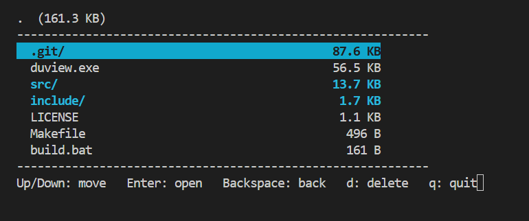
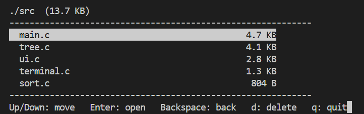

# duview

An interactive disk usage visualizer for the terminal, built from scratch in C.

`duview` scans a folder once, calculates the size of every file and folder, sorts everything largest-first, and lets you browse the result with the keyboard.




---

## Table of Contents

1. [Project Description](#project-description)
2. [Goals](#goals)
3. [Specification](#specification)
4. [Design](#design)
5. [Getting Started](#getting-started)
6. [Usage](#usage)
7. [Project Structure](#project-structure)
8. [Known Limitations](#known-limitations)
9. [Future Work](#future-work)
10. [What I Learned](#what-i-learned)
11. [License](#license)

---

## Project Description

### The problem

When a drive fills up, the question is simple: **what is using the space?**

Without a dedicated tool, the usual answer is to run `du -sh *` (or open Properties in Explorer), find the biggest folder, go into it, and repeat. Every step is manual, and Explorer does not show folder sizes in one sorted view.

### What duview does

- Scans a directory tree **once** and keeps it in memory.
- Shows every folder's **total size**, sorted largest-first.
- Lets you move through the tree instantly with the arrow keys, because the data is already in memory.
- Optionally deletes the highlighted file or folder, after a confirmation.

### Honest framing

This problem is already solved by mature tools such as `ncdu`, WinDirStat and WizTree. `duview` is a **from-scratch reimplementation** built to learn systems programming in C: recursion, dynamic memory, file system APIs, data structures and terminal control. It does not claim to be safer, faster or more complete than those tools.

---

## Goals

- Build a complete, working tool in C with no external libraries.
- Practice recursion with a clear base case (scanning and sorting).
- Practice manual memory management (`malloc`, `free`) on a tree structure.
- Use real operating system APIs (`opendir`, `readdir`, `stat`).
- Handle the terminal directly: raw key input, ANSI escape codes, the alternate screen.
- Split the code into small modules, each with one job.
- Keep a clean Git history with small, meaningful commits.

---

## Specification

### Features

| Feature | Description |
|---|---|
| Recursive scan | Walks the whole directory tree and totals the size of each folder. |
| Sorted view | Every folder's entries are sorted by size, largest first. |
| Readable sizes | Sizes shown as B, KB, MB, GB or TB (1024-based). |
| Keyboard navigation | Move the highlight, open folders, go back. |
| Full path header | The header shows the current path and its total size. |
| Colors | Folders are cyan and bold, files use the default color. |
| Scrolling | Long lists scroll inside the window, and the selected row stays visible. |
| Flicker-free redraw | Frames are drawn over the old one instead of clearing the screen. |
| Delete | Removes a file or folder (recursively), with a `y/n` confirmation. |
| Clean exit | Leaves the alternate screen so your terminal returns as it was. |

### Keys

| Key | Action |
|---|---|
| Up / Down | Move the highlight |
| Enter | Open the highlighted folder |
| Backspace | Go back to the previous folder (cursor position is restored) |
| `d` | Delete the highlighted entry (asks for confirmation, then `y` to confirm) |
| `q` | Quit |

### Command line

```
duview [path]
```

- `path` is optional. If omitted, the current folder (`.`) is scanned.

### Platform

- **Windows only** for now. `terminal.c` uses `conio.h` and `windows.h`.

---

## Design

### Program flow

```
main
 ├── build_tree()   scan the folder into an in-memory tree
 ├── sort_tree()    sort every folder's children, largest first
 ├── loop:
 │     ├── render()     draw the current folder
 │     └── read_key()   wait for a keypress, then update state
 └── free_tree()    release all memory
```

### Data structure: the tree

Each file or folder is one `Node`:

```c
typedef struct Node {
    char name[256];
    long long size;
    int is_dir;
    int child_count;
    struct Node *children;   // dynamically allocated array
} Node;
```

- A plain file has no children, and its size comes from `stat()`.
- A folder's size is the sum of its children's sizes.
- The whole tree is built **once**. Opening a folder only moves a pointer, so navigation is instant.

### Data structure: the history stack

Pressing Enter pushes a `Frame` before moving down:

```c
typedef struct {
    Node *folder;     // the folder we came from
    int selected;     // cursor row in that folder
    int scroll;       // scroll offset in that folder
    int path_len;     // length of the path text before descending
} Frame;
```

Backspace pops the last frame and restores all four values. This is a stack (last in, first out). The same stack lets delete update the totals of every parent folder without rescanning.

### Key design decisions

- **Recursion with a base case.** `build_tree` and `sort_tree` stop at plain files.
- **Two-pass directory read.** The first pass counts entries so the child array is allocated at exactly the right size.
- **Safe string functions.** `strncpy` with a manual `'\0'` and `snprintf` instead of `strcpy` and `sprintf`, to prevent buffer overflows.
- **Overflow-safe comparator.** The `qsort` comparator uses explicit comparisons, not subtraction, to avoid a `long long` to `int` overflow.
- **Alternate screen buffer** (`\033[?1049h`). The program gets its own full-screen area, and the user's terminal is restored on exit.
- **Redraw without clearing.** Cursor home (`\033[H`), erase-to-end-of-line (`\033[K`) and erase-below (`\033[J`) avoid flicker.
- **One job per file.** `tree.c` handles data and disk, `sort.c` sorting, `terminal.c` keys and console, `ui.c` drawing, `main.c` ties them together.

---

## Getting Started

### Prerequisites

- Windows 10 or later
- [MSYS2](https://www.msys2.org/) with the **UCRT64** environment
- GCC and Make, installed from the **MSYS2 UCRT64** shell:

```bash
pacman -S mingw-w64-ucrt-x86_64-gcc make
```

> An old MinGW gcc will not work: its headers lack `ENABLE_VIRTUAL_TERMINAL_PROCESSING`, which `terminal.c` needs.

### Get the code

```bash
git clone https://github.com/buildwithujjwal/duview.git
cd duview
```

### Build with Make (recommended)

Open the **MSYS2 UCRT64** shell, go to the project folder and run:

```bash
cd /e/path/to/duview     # use forward slashes and a lowercase drive letter
make
```

To remove the built program:

```bash
make clean
```

### Build with build.bat (from PowerShell)

```powershell
.\build.bat
```

- `build.bat` calls the MSYS2 shell at `C:\msys64`. If MSYS2 is installed elsewhere, edit the path inside the file.

### Check the build

```powershell
dir duview.exe
```

The timestamp should be from just now. A failed build can leave an **old** `duview.exe` in place, which looks like your new code is broken.

---

## Usage

```powershell
# Scan the current folder
.\duview.exe .

# Scan a specific folder (use forward slashes)
.\duview.exe C:/Users/yourname/Downloads
```

Example screen:

```
./src  (11.8 KB)
------------------------------------------------------------
  main.c                                   3.1 KB
  tree.c                                   2.7 KB
  ui.c                                     2.4 KB
  terminal.c                               1.3 KB
  sort.c                                   804 B
------------------------------------------------------------
Up/Down: move   Enter: open   Backspace: back   d: delete   q: quit
```

### Warning about delete

- Delete is **permanent**. There is no Recycle Bin.
- Only use `d` on files you are sure about.
- Test on a throwaway folder first.

---

## Project Structure

```
duview/
├── .gitignore
├── LICENSE
├── Makefile
├── README.md
├── build.bat
├── docs/
│   └── screenshot.png
├── include/
│   ├── sort.h
│   ├── terminal.h
│   ├── tree.h
│   └── ui.h
└── src/
    ├── main.c        entry point, input loop, history stack
    ├── sort.c        recursive sort, largest first
    ├── terminal.c    key reading, ANSI enabling, console height (Windows)
    ├── tree.c        scanning, in-memory tree, delete
    └── ui.c          drawing the screen
```

---

## Known Limitations

- **Windows only.** `conio.h` and `windows.h` are Windows-specific.
- **Symlinks and junctions.** `stat()` follows links, so a link loop could recurse forever, and delete could follow a link into its target. Using `lstat()` and skipping links would fix this.
- **Unreadable folders count as 0.** Permission-denied folders are treated as empty without a message, so totals can be lower than Explorer's.
- **No progress indicator.** The screen stays blank while scanning, and a large drive can take minutes.
- **Memory use.** Each node is about 280 bytes, so a drive with millions of files needs hundreds of megabytes of RAM.
- **Sizes are file sizes, not disk usage.** `st_size` is reported, which can differ from "Size on disk" in Explorer.
- **Delete is permanent**, and a folder containing a file that cannot be removed is left partly deleted. The on-screen list is only updated when the delete succeeds.
- **Sort order after delete.** A parent folder's size shrinks after a delete, so it may be out of order until the next scan.
- **Equal sizes have no tie-break**, so their order is not guaranteed.
- **Limits:** paths use a 1024-byte buffer, and back-navigation remembers up to 256 levels.
- **Empty folders cannot be opened** with Enter.

---

## Future Work

- Skip symlinks with `lstat()`.
- Show "(cannot read)" for folders that cannot be opened.
- Add a progress counter during the scan.
- Linux support with `termios` and `#ifdef`.
- Multi-threaded scanning of top-level folders.
- Deterministic sort order for equal sizes.

---

## What I Learned

- Recursion with a base case, and how a tree maps onto a folder structure.
- Dynamic memory: `malloc`, `free` and freeing a whole tree recursively.
- File system APIs: `opendir`, `readdir`, `stat` and the `S_ISDIR` macro.
- Using a stack for navigation history.
- Terminal control with ANSI escape codes, raw key input and the alternate screen.
- Splitting a program into modules with header files and header guards.
- Debugging real problems: a `"."` skip typo that caused endless recursion, a build that failed silently and left a stale `.exe`, and a screen that scrolled because of a newline on the last row.

---

## License

This project is licensed under the MIT License. See the [LICENSE](LICENSE) file for details.

## Author

**Ujjwal**, [github.com/buildwithujjwal](https://github.com/buildwithujjwal)
